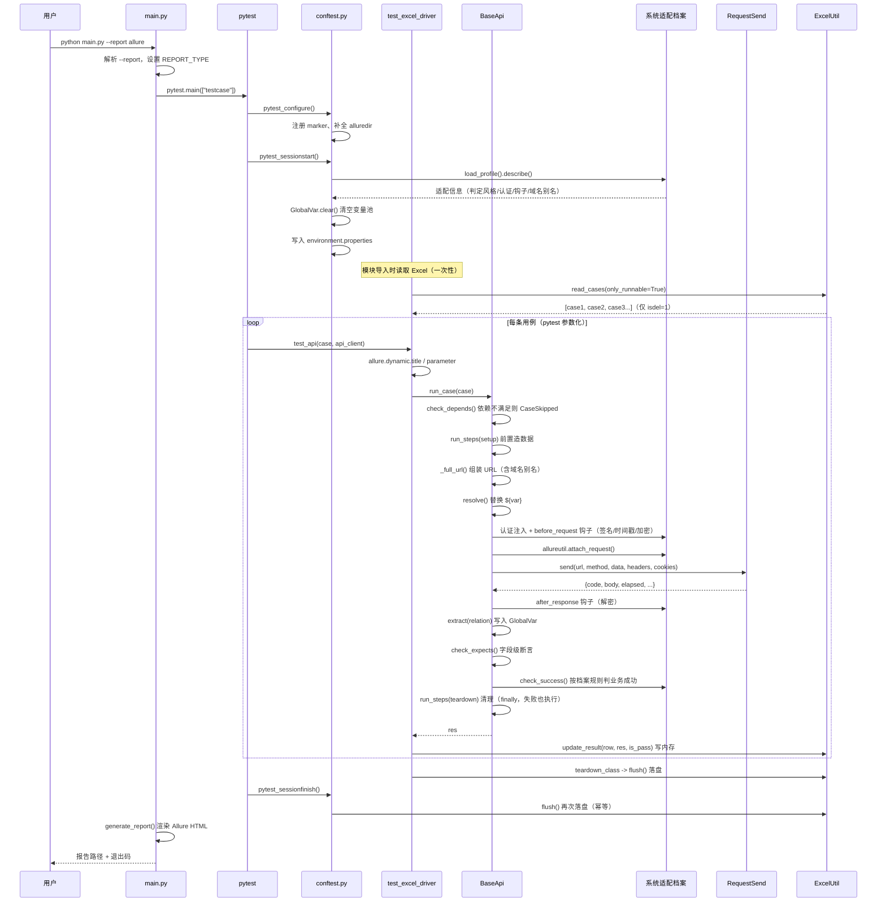

# 框架设计说明

> 本文面向**要改动框架本身**的开发同学。读完你能回答：
> 为什么这么分层？一次执行到底发生了什么？核心机制在哪实现？改动会影响什么？

---

## 一、设计目标与约束

### 目标

| 目标 | 落地方式 |
| --- | --- |
| 用例与代码解耦 | 数据驱动，用例写在外部的 Excel / YAML / DB |
| 接口变更成本低 | PO 模式，接口地址与参数只写一遍 |
| 支持接口间传参 | 全局变量池 + `${var}` 占位符 + 关联表达式 |
| 执行逻辑单一 | 三种数据源共用同一个 `BaseApi`，只换 loader |
| 失败可定位 | Allure 步骤树 + 请求/响应附件 + 分级日志 |
| 缺依赖不崩 | Allure / pymysql / Allure 报告渲染全部可选且自动降级 |

### 约束（有意为之）

- **不做并发**：当前为单进程顺序执行，变量池依赖执行顺序（登录在前）。
- **不引入额外抽象层**：没有引入 Page Factory、自研断言库等，保持薄封装，降低学习成本。
- **不追求 100% 还原真实浏览器的请求**：这是接口层测试，不涉及 UI。

---

## 二、分层架构

```
┌──────────────────────────────────────────────────────────────┐
│                        main.py  (入口)                        │
│             解析 --report，调用 pytest.main()                 │
└───────────────────────────┬──────────────────────────────────┘
                            │
┌───────────────────────────▼──────────────────────────────────┐
│                    testcase/  用例层                          │
│   conftest.py  全局配置 / fixture / 会话钩子                   │
│   test_excel_driver.py   test_yaml_driver.py                  │
│   test_sql_driver.py     test_login.py                        │
│   职责：组织执行流程、断言期望、回写结果                        │
└───────────────────────────┬──────────────────────────────────┘
                            │ 调用
┌───────────────────────────▼──────────────────────────────────┐
│                      api/   接口层（PO）                       │
│   base_api.py  URL 组装 / 参数化 / 认证 / 钩子 / 关联 / 断言   │
│                / 生命周期（setup-teardown-depends）/ 分页      │
│   login_api.py   dict_api.py   admin_api.py                   │
│   职责：一个接口一个方法，屏蔽所有 HTTP 细节                     │
└───────┬───────────────────────────────────┬──────────────────┘
        │ 使用                              │ 使用
┌───────▼──────────────────┐    ┌───────────▼──────────────────┐
│   utils/   工具层         │    │   common/   公共层             │
│   requestsutil  HTTP      │    │   ★ profile.py  系统适配档案   │
│   excelutil     Excel     │    │   ★ auth.py     认证策略       │
│   yamlutil      YAML      │    │   ★ response.py 响应判定       │
│   mysqlutil     MySQL     │    │   ★ hooks.py    钩子与签名     │
│   logutil       日志      │    │   ★ asserts.py  断言算子       │
│   allureutil    报告      │    │   base.py       参数化核心     │
│                           │    │   variable.py   全局变量池     │
│                           │    │   exceptions.py 异常定义       │
│                           │    │   project_path / read_config   │
└───────┬──────────────────┘    └───────────┬──────────────────┘
        │                                    │
┌───────▼────────────────────────────────────▼──────────────────┐
│                  config/   配置层（唯一配置来源）              │
│   settings.py（路径/开关/环境/DB）  conf.ini（外部配置）        │
│   systems/*.ini  ★ 系统适配档案（换被测系统只改这里）           │
└───────────────────────────┬──────────────────────────────────┘
                            │ 读取
┌───────────────────────────▼──────────────────────────────────┐
│                     data/   数据层                            │
│        api_tables.xlsx       cases/*.yaml                     │
└──────────────────────────────────────────────────────────────┘
```

带 ★ 的五个模块是 2.4.0 新增的**系统适配层**，它们只被 `api/base_api.py` 使用，
不向上依赖任何人；不接新系统时它们处于「完全不影响」的状态：

```
                  api/base_api.py
                        │
        ┌───────────────┼───────────────┬──────────────┐
        ▼               ▼               ▼              ▼
  profile.py        auth.py       response.py      hooks.py
   （差异注册表）    （令牌怎么带）  （成功怎么判）   （签名/加解密）
        │
        └── 只读 config/systems/<系统>.ini
                        ▲
                  asserts.py（字段级断言的统一实现，被 base_api 与 expects 共用）
```

### 依赖方向（单向下行，无循环）

```
data ─→ api ─→ testcase
config ← 所有层（只读）
common ← utils ← api
```

| 层 | 允许依赖 | 禁止依赖 |
| --- | --- | --- |
| `config` | 标准库 | 任何业务模块 |
| `common` | `config` | `utils` / `api` / `testcase` |
| `utils` | `config` / `common` | `api` / `testcase` |
| `api` | `config` / `common` / `utils` | `testcase` |
| `testcase` | 全部 | — |

> **违反依赖方向是最常见的技术债来源**。若发现 `api/` 里 import 了 `testcase/`，
> 那一定是设计错误，应把公共逻辑下沉。

### 分层职责边界

| 层 | 该做的事 | 不该做的事 |
| --- | --- | --- |
| 数据层 | 提供用例数据 | 不含任何逻辑 |
| 接口层 `api` | 描述「怎么调接口」 | 不写期望值、不组织用例流程 |
| 用例层 `testcase` | 描述「测什么、期望什么」 | 不出现 url 拼接、json 序列化 |
| 工具层 `utils` | 提供可复用的技术能力 | 不含业务语义 |
| 公共层 `common` | 参数化、变量池、**系统差异的抽象** | 不依赖上层、不含具体系统语义 |
| 配置层 `config` | 提供配置、路径与**系统档案** | 不写业务逻辑 |

**判断标准**：如果一段代码里出现了 `assert expected == 200`，它属于用例层；
如果出现了 `headers["Content-Type"] = "application/json"`，它属于接口层；
如果出现了 `requests.get(...)`，它属于工具层；
如果出现了「**某个具体系统的约定**」（字段名 `status`/`code`/`success`、头名 `access-ticket`、
盐值 `abc123`），它属于**档案**（`config/systems/*.ini`），不属于任何一层代码。

---

## 三、一次执行的完整流程

以「Excel 数据驱动、第 3 条用例需要 `${ticket}`」为例：



### 关键顺序点

| 顺序 | 为什么重要 |
| --- | --- |
| `GlobalVar.clear()` 在会话开始时 | 避免上次运行的 ticket 等脏数据被误用 |
| Excel 读取在**模块导入时** | 只读一次，参数化需要确定用例列表 |
| 用例按 Excel 行序执行 | 登录必须排在依赖它的用例之前（或显式声明 `depends`） |
| 认证 → 钩子 → 发送 | 签名必须覆盖「带令牌的完整报文」 |
| 发送 → 解密 → 断言/关联 | 加密系统的字段断言与关联提取都必须基于明文 |
| `setup` 在主请求前、`teardown` 在 `finally` | 造的数据一定要清掉，否则污染后续用例与下次构建 |
| 结果先写内存、最后统一落盘 | 避免每条用例都 save 整个 xlsx |
| 回写在 `finally` 中 | 用例失败也要记录，便于统计 |
| `check_success()` 在 `run_case` 内 | Excel / YAML / MySQL 三个驱动共用同一套判定规则，换系统只改档案 |

---

## 四、核心机制

### 4.1 URL 组装

实现：`BaseApi._full_url()`

```python
def _full_url(self, path):
    if path.lower().startswith(("http://", "https://")):
        return path                          # 绝对地址原样用
    if not self.base_url:
        return path                          # 未配置 base_url，路径原样用
    return "{}/{}".format(self.base_url, path.lstrip("/"))
```

优先级：**用例自带完整地址 > 全局 base_url 拼接 > 原样返回**。

> 设计理由：兼容"大部分用例同域名 + 少数用例跨域"的实际情况，
> 也保证旧用例（写全地址）迁移过来不用改。

> 请求体数据放在哪（query / json / form / 文件）见 [4.9 请求体挂载规则](#49-请求体挂载规则http-方法--content-type)。

### 4.2 参数化 `${var}`

实现：`common/base.py`

| 函数 | 作用 |
| --- | --- |
| `find(data)` | 正则 `\$\{(.*?)\}` 找出所有占位符名 |
| `relace(ori, replace_data)` | `Template.safe_substitute` 替换为变量池的值 |
| `relace_obj(ori)` | 替换后再 `json.loads` 还原成 Python 对象 |
| `safe_loads(text, default)` | 安全解析字符串为对象（json → literal_eval） |

关键设计点：

1. **只在存在占位符时才替换**（`BaseApi.resolve`）——避免无谓的序列化开销。
2. **使用 `safe_substitute` 而非 `substitute`**——变量缺失时不抛异常，替换为空串。
   好处：单条用例缺少变量只会导致断言失败，不会让整轮测试崩溃。
3. **【重要】替换后的字符串要还原成对象**——因为 `Template` 只能处理字符串。
   所以流程是：`dict → json.dumps → 替换 → json.loads → dict`。
   这也是为什么 `request_body` 里写 `${ticket}` 后仍能作为 JSON 发送。
4. **类型转换的陷阱**：所有值在替换时会被 `str()` 化成字符串。
   若原本是数字 `123`，替换后是 `"123"`。对于 JSON body 无影响（还原时会变回数字），
   但若把变量用在**非 JSON** 场景（如表单），需注意类型。

### 4.3 关联提取

实现：`BaseApi.extract()` + `common/base.py: parse_relation / parse_expression`

```
Excel relation 列：  ticket=body.data.ticket
                        │
                        ├─ 按 "," 拆分多个表达式
                        │
                        ├─ parse_expression 按 "=" 拆出 变量名 与 路径
                        │
                        ├─ parse_relation 按 "." 逐层取值
                        │      res["body"]["data"]["ticket"]
                        │
                        └─ GlobalVar.set("ticket", 值)
```

**路径根是「完整响应」**（即包含 `code` / `body` 的字典），
所以响应体字段必须写成 `body.xxx`。这一点与旧框架一致，改造成本最低。

支持的能力：

| 能力 | 示例 |
| --- | --- |
| 多级嵌套 | `uid=body.data.user.id` |
| 列表下标 | `first=body.data.rows.0.name` |
| 多变量（逗号分隔） | `ticket=body.data.ticket,uid=body.data.user.id` |
| 空值/None | `relation` 写 `None` / `null` / 空 → 不提取 |

**容错设计**：`parse_relation` 在路径不存在时返回 `None` 而不抛异常，
且**不修改入参**（旧实现用 `del var[0]` 会污染调用方列表）。

### 4.4 断言体系

`BaseApi` 提供三级断言，均失败即抛 `AssertionError`（pytest 记为失败）：

| 方法 | 断言对象 | 典型用途 |
| --- | --- | --- |
| `check_status(code)` | HTTP 状态码（`res["code"]`） | 验证网络层正常 |
| `check_business_code(code, path="status")` | 业务状态码（默认 `body.status`） | **最常用**，与 Excel `expected_code` 对应 |
| `check_json(path, expected)` | 任意路径的值（根为完整响应） | 验证具体字段，如 `body.data.ticket` |

**为什么业务断言只取 `body.status`？**
因为对接系统的业务码统一放在 `status` 字段。若某个接口用别的字段，
可通过 `path` 参数指定，如 `check_business_code(0, path="code")`。

**约定**：`check_json` 的路径根与关联表达式一致（完整响应），
避免开发者需要记住两套路径规则。

### 4.5 全局变量池

实现：`common/variable.py: GlobalVar`

| 方法 | 作用 |
| --- | --- |
| `set(key, value)` | 写入（支持 `a.b.c` 形式的 key） |
| `get(key, default)` | 读取，支持点号路径逐层查找 |
| `update(mapping)` | 批量写入 |
| `has(key)` | 是否存在 |
| `all()` | 取全部（返回副本） |
| `clear()` | 清空（会话开始时调用） |

**为什么用类 + 类方法而不是实例？**
需要跨用例、跨文件共享且不依赖 fixture 传递——用类属性最简单。
**线程安全**：内部用 `RLock` 保护，为将来并行执行留余地（当前单线程顺序执行）。

**命名冲突**：后写入的值会覆盖先写入的。若两个接口都提取 `id`，后者覆盖前者。
建议关联变量名带上业务前缀，如 `orderId`、`userId`。

### 4.6 结果回写与缓存

实现：`utils/excelutil.py: ExcelUtil`

**问题**：旧实现每条用例 `load_workbook` + `save` 一次，用例多时极慢。

**方案**：工作簿级缓存 + 延迟落盘。

```
_load(filename)  → 类级 _cache 命中则直接返回
update_result()  → 只改内存中的 cell
flush()          → 统一 save，然后清空缓存
```

`flush()` 被调用两次（`teardown_class` 与 `pytest_sessionfinish`），
第二次时缓存已空，属于无害的幂等操作。

**另一个改进**：用真实物理行号（`__row__`）回写，而不是旧实现的
`row_id = id + 1` 假设。这样即使中间插入行、id 不连续也不会写错位置。

### 4.7 数据源抽象

三种数据源没有共同基类，而是通过**统一的数据契约**实现解耦：

```
用例数据 = 一个 dict，含 url / method / headers / cookies / request_body / relation
```

| 数据源 | Loader | 产出 |
| --- | --- | --- |
| Excel | `ExcelUtil.read_cases()` | `[{...}, ...]`，附加 `__row__` |
| YAML | `yamlutil.read_cases()` | `[{...}, ...]`，附加 `__source__` |
| MySQL | `RdTestcase.is_run_data()` | `[{...}, ...]` |

因为 `BaseApi.run_case(case)` 只认这个 dict 契约，所以**加一种新数据源
不需要改接口层与断言逻辑**——只需写一个 loader 产出同样结构的列表。

**这是框架最重要的扩展点**，详见 [04-开发指南 · 新增数据源](04-开发指南.md#五新增数据源)。

> 注意 MySQL 驱动略有不同：它的地址由 `test_config` 域名 + `port_num` 拼接，
> 因此不是直接调 `run_case`，而是先 `repo.build_case_url()` 再 `request()`。
> 这是为了**沿用旧系统的既有业务规则**而做的兼容处理。

### 4.8 Allure 集成

实现：`utils/allureutil.py`

**核心设计：全量降级**。未安装 `allure-pytest` 时，所有方法变为空操作：

```python
try:
    import allure
except ImportError:
    allure = None

ALLURE_AVAILABLE = allure is not None
```

这样做的价值：把 Allure 从"必需依赖"降级为"可选增强"，
使框架在干净环境、CI 精简镜像中依然能跑。

| 方法 | 作用 |
| --- | --- |
| `attach_request(...)` | 附加请求方法/地址/头/参数/体 |
| `attach_response(res)` | 附加状态码/耗时/响应体（JSON 高亮） |
| `attach_text/json(name, c)` | 附加自定义内容 |
| `step(title)` | 步骤上下文（无 allure 时返回 `nullcontext`） |
| `write_environment(dir, env)` | 写 `environment.properties`，报告「环境」页展示 |

**附件大小保护**：`MAX_ATTACH_LEN = 20000`，超长内容自动截断，
避免超大响应体把报告渲染拖垮。

**接入位置**：`BaseApi.request()` 内部自动附加请求与响应。
好处是用例层零成本获得附件；代价是接口层与 Allure 有了耦合——
但通过 `allureutil` 这一层薄封装把耦合控制在可接受范围。

---

### 4.9 请求体挂载规则（HTTP 方法 × Content-Type）

实现：`utils/requestsutil.py` 的 `RequestSend.body_location()`

框架不要求用例关心"参数该放 query 还是 body"，由 `body_location()` 统一判定。
**这是唯一的判定入口**——请求层（实际发送）与接口层（Allure 附件展示）都调用它，
保证「报告里看到的」与「实际发出的」永远一致。

| method | Content-Type | 挂载位置 | 说明 |
| --- | --- | --- | --- |
| `get` | 任意 | `params` | 只读方法，数据一律进 query |
| `head` | 任意 | `params` | 同上 |
| `options` | 任意 | `params` | 同上 |
| `delete` | 未声明 | `params` | **历史兼容行为**，保持默认不变 |
| `delete` | `application/json` | `json` | 支持 REST 批量删除携带请求体 |
| `delete` | `x-www-form-urlencoded` | `data` | |
| `delete` | `multipart/form-data` | `files` | |
| `post` | 未声明 / `application/json` | `json` | 默认按 JSON 提交 |
| `put` | 同上 | `json` | |
| `patch` | 同上 | `json` | |
| `post` / `put` / `patch` | `x-www-form-urlencoded` | `data` | |
| `post` / `put` / `patch` | `multipart/form-data` | `files` | |
| 任意写方法 | 其它（无法识别） | `json` | 兜底，与默认行为一致 |

设计取舍：

- **`delete` 为什么特殊**：REST 实践中 DELETE 既可无体（`?id=1`）也可带体（批量删除传 `ids`）。
  未声明 Content-Type 时沿用旧的 query 行为，避免破坏存量用例；一旦显式声明了 Content-Type，
  就按声明的语义挂载——语义更清晰，也不会静默丢掉请求体。
- **`get` 为什么不支持 body**：GET 携带请求体属反模式，多数网关会丢弃，明确不提供支持，
  以免写出"本地能过、线上失败"的用例。
- **优先级**：`send()` 显式传入的 `params=` / `files=` 覆盖自动判定，用于极少数需要
  同时携带 query 与 body 的场景。

> 单测覆盖：`tests/test_utils_requestsutil.py::TestBodyLocation` 与 `TestBuildKwargs`
> 穷举了上表全部组合，`TestSend` 另对七种方法做全链路验证。见 [07-单元测试](07-单元测试.md)。

### 4.10 系统适配（一套框架跑多套系统）

前面 4.1~4.9 描述的都是「机制」。但机制里藏着一个假设：**所有系统的约定都一样**。
真实情况是不同系统的约定差异极大：

| 差异 | 政务 | 财务/ERP | 商城 | 中台 |
| --- | --- | --- | --- | --- |
| 成功判定 | `body.status == 200` | `body.code == 0` | `body.success == true` | `body.errno == 0` |
| 令牌位置 | 自定义头 | Cookie | `Authorization: Bearer` | `Bearer` / API Key |
| 请求体 | JSON | 表单 | JSON | JSON / XML |
| 编码 | UTF-8 / GBK | GBK | UTF-8 | UTF-8 |
| 域名 | 单一 | 单一 | 多域名 | 网关 + 多服务 |
| 签名加密 | 少 | 多 | 多 | 多 |

把这些差异写进代码，就等于把框架钉死在**一个**系统上。因此 2.4.0 把差异整体抽成
**一份声明式档案**（`config/systems/<系统>.ini`），由 `common/` 下的五个模块解释执行：

```
                  ┌───────────────────────────────────────┐
                  │   config/systems/<系统>.ini（档案）    │
                  │   域名/编码/报文格式/响应判定/认证/钩子 │
                  └───────────────────┬───────────────────┘
                                      │ load_profile()
                  ┌───────────────────▼───────────────────┐
                  │        common/profile.py（档案层）      │
                  │   把 ini 解析成 SystemProfile 对象      │
                  └───┬───────────┬───────────┬───────────┘
                      │           │           │
              .auth   │   .response│    .hooks │   .hosts / .headers / .encoding
                      ▼           ▼           ▼
            common/auth.py  common/response.py  common/hooks.py
              （怎么鉴权）     （怎么判成功）      （签名/加解密）
                      │           │           │
                      └───────────┴───────────┘
                                  │ 被 base_api 使用
                                  ▼
                        api/base_api.py
```

**执行顺序（顺序本身就是设计）**：

```
1. 取出档案 → 2. URL 组装（含域名别名）
3. 参数化 ${var}
4. 认证注入                 ← 令牌先就位
5. before_request 钩子       ← 签名/时间戳/加密，必须覆盖认证后的完整报文
6. 发送
7. after_response 钩子       ← 解密，必须在断言与关联提取之前
8. 关联提取 ${var} 入池
9. 字段断言（expects）
10. 业务成功判定（按档案规则）
11. teardown 清理（无论成败）
```

为什么第 5 步必须在第 4 步之后、第 7 步必须在第 9 步之前：

- **签名覆盖认证信息**：真实系统的签名算法通常把 token 一起纳入计算。
  若先签名再注入令牌，服务端校验必然失败。
- **先解密再断言**：加密系统返回的 `data` 是密文，不解密则字段断言永远不过，
  关联提取出来的令牌也是密文——后续请求全部 401。

**向后兼容的关键设计**：内置 `default` 档案的取值刻意与改造前逐项等价：

| 档案项 | 改造前行为 | `default` 档案 |
| --- | --- | --- |
| 成功判定 | `body.status == expected_code` | `style = status` → `body.status` |
| 认证 | 用例自己写 `${ticket}` 请求头 | `type = none` |
| 域名 | 只拼 `RunConfig.BASE_URL` | `base_url = ""`、`hosts = {}` |
| 编码 / 报文格式 | 自动判断 / 先 json 后文本 | `encoding = None`、`response_format = auto` |
| 钩子 | 无 | 无 |

因此**不配置任何档案时行为与改造前完全一致**，存量用例零迁移；
有专门单测（`tests/test_common_profile.py::TestBuiltinDefault`）守护这组等价关系——
一旦有人不小心改了默认值，测试会立刻红。

> **运行时参数的三级回退**：域名与超时/证书是「环境属性」而非「系统属性」，
> 因此走 `AMSAPI_* / conf.ini` > 档案 > 代码默认 的链路；
> 编码、报文格式、响应判定、认证、钩子则只由档案决定（属于系统固有约定）。
> 实现上由 `settings.ENV_OVERRIDES` 记录「哪些项被环境变量覆盖过」来区分
> 「档案显式写了值」与「档案没写、应回退」。

> 完整字段说明与五类系统的接入示例见 [08-系统适配指南](08-系统适配指南.md)。

---

## 五、关键设计决策与取舍

| 决策 | 选择 | 备选 | 理由 |
| --- | --- | --- | --- |
| 用例数据格式 | Excel 为默认，同时支持 YAML/DB | 只支持一种 | 业务同学需要表格视图，开发需要 diff |
| 路径根 | 关联/断言都以**完整响应**为根 | 只以 body 为根 | 兼容旧用例，迁移零成本 |
| 变量存储 | 类属性（`GlobalVar`） | fixture / context | 跨文件共享简单；fixture 传递会让用例签名臃肿 |
| Excel 写入 | 缓存 + 延迟落盘 | 每条即写 | 性能差 10 倍以上 |
| 数据源抽象 | 统一 dict 契约，无基类 | 抽象基类 + 工厂 | 三种数据源结构差异大（MySQL 要拼 URL），强行抽象反而更复杂 |
| Allure | 可选 + 自动降级 | 强依赖 | 保证精简环境可运行 |
| 断言 | 内置 3 个方法 | 引入自研断言库 | 保持薄封装，降低学习成本 |
| 表达式解析 | 正则 + `Template` | `eval()` | **安全**，旧实现的 `eval()` 有注入风险 |
| 并发 | 暂不支持 | pytest-xdist | 变量池依赖顺序，并行需改造，暂缓 |

### 与旧版本的对应关系

| 旧实现 | 新实现 | 变化原因 |
| --- | --- | --- |
| `DynamicParam` 类属性 hack | `common/variable.py: GlobalVar` | 统一入口、加锁、支持路径读写 |
| `eval()` 解析 Excel 内容 | `base.safe_loads()` | 消除代码注入风险 |
| 每条用例 load + save Excel | 缓存 + `flush()` | 性能 |
| post 仅匹配两种精确 headers | 按 Content-Type 自动挂载 | 旧实现其他情况返回 `None` 导致崩溃 |
| `parse_relation` 用 `del var[0]` | 不修改入参 | 旧实现污染调用方的列表 |
| `cursor=pymysql.cursors.DictCursor` | `cursorclass=` | 旧参数名错误 |
| 模块级 `MysqlUtil()` 导入即连库 | 惰性连接 | 没装数据库的环境也能用框架 |
| 无报告 / pytest-html | Allure（+ HTML 备选） | 失败定位效率 |

---

## 六、扩展点

按「改动风险由低到高」排列：

| 我想… | 改哪里 | 风险 |
| --- | --- | --- |
| 加用例数据 | `data/`（Excel / YAML） | 无 |
| 加接口 | `api/xxx_api.py` 新方法 | 低 |
| 加断言类型 | `BaseApi` 新增 `check_xxx` | 低 |
| 加工具 | `utils/` 新模块 | 低 |
| 加数据源 | 新 loader + 新 driver | 中 |
| 改参数化语法 | `common/base.py` | 高（影响全部用例） |
| 改关联路径根 | `BaseApi.extract` + 所有 relation | 高（影响全部用例） |

**改动前的自检**：

1. 是否违反依赖方向？
2. 是否会影响现有用例（向后兼容）？
3. 是否需要在文档中同步更新？
4. 是否有测试覆盖？（建议先在本地跑 `python main.py` 全量）

---

## 七、已知限制

| 限制 | 影响 | 可行的改进方向 |
| --- | --- | --- |
| 不支持并发执行 | 用例多时耗时长 | 变量池改为线程局部 + pytest-xdist |
| 变量池无序依赖 | 用例顺序不能随意调整 | 引入显式依赖声明或 setUp 前置 |
| Excel 回写在用例失败时可能残留 | 极端情况结果未落盘 | 已用 `teardown_class` + `sessionfinish` 双保险 |
| 无数据清理/环境准备机制 | 依赖被测系统自带测试数据 | 增加 fixture 做 setup/teardown |
| 断言仅覆盖状态码与字段值 | 无法做 schema 校验 | 引入 jsonschema |
| 用例名依赖 Excel id | id 重复时报告难区分 | 增加唯一性校验 |

---

## 八、术语表

| 术语 | 含义 |
| --- | --- |
| PO / API Object | Page Object 思想在接口测试中的应用：一个接口 = 一个类方法 |
| 数据驱动 | 用例逻辑固定，数据来自外部文件/DB |
| 关联 / correlation | 从上游接口响应中取值，传给下游接口 |
| 变量池 | 存储关联变量的全局容器（`GlobalVar`） |
| marker | pytest 的标签，用于筛选用例 |
| fixture | pytest 的依赖注入机制，提供用例所需的资源 |
| 契约（数据契约） | 这里指用例 dict 的字段约定（url/method/headers/...） |
| 降级 | 缺少可选依赖时自动退化为空操作，不报错 |
